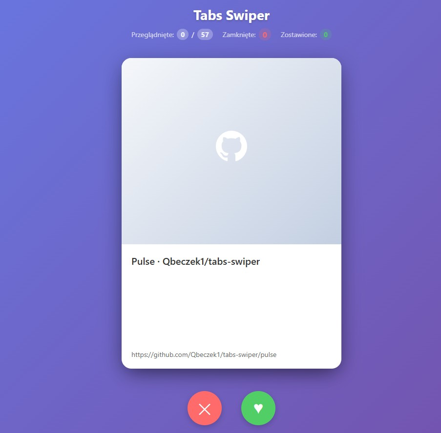

# Tabs Swiper

[](https://github.com/Qbeczek1/tabs-swiper/releases)
[](LICENSE)
[](https://chrome.google.com/webstore)
[](https://developer.chrome.com/docs/extensions/mv3/)

Chrome extension for swiping through tabs like Tinder - swipe left to close, swipe right to keep. Idealne do szybkiego porządkowania setek otwartych zakładek.



## 🎯 Features

- ✅ Przeglądanie wszystkich zakładek ze wszystkich okien Chrome
- ✅ Favicon + tytuł + URL jako podgląd (lekki i szybki)
- ✅ Swipe gesty (myszka/touch)
- ✅ Przyciski do szybkiej akcji
- ✅ Obsługa klawiatury (strzałki, Escape)
- ✅ Animacje w stylu Tinder
- ✅ Efekt 3D - widać kolejne karty pod spodem
- ✅ Interfejs po angielsku i polsku (wybierany automatycznie wg języka przeglądarki)

## 📦 Installation

### Krok 1: Pobierz repozytorium

```bash
git clone https://github.com/Qbeczek1/tabs-swiper.git
cd tabs-swiper
```

Lub pobierz jako [ZIP](https://github.com/Qbeczek1/tabs-swiper/archive/refs/heads/master.zip) i rozpakuj.

### Krok 2: Załaduj rozszerzenie w Chrome

1. Otwórz Chrome i przejdź do `chrome://extensions/`
2. Włącz "Tryb deweloperski" (Developer mode) w prawym górnym rogu
3. Kliknij "Załaduj rozpakowane" (Load unpacked)
4. Wybierz katalog `tabs-swiper`

## 🚀 Usage

1. **Otwórz Swiper:** Kliknij ikonę rozszerzenia w pasku narzędzi Chrome
2. **Przeglądaj zakładki:** Zobaczysz karty z favicon, tytułem i URL każdej zakładki
3. **Decyduj:**
   - **Swipe left / przycisk ✕ / klawisz ←** - zamknij zakładkę
   - **Swipe right / przycisk ♥ / klawisz →** - zostaw zakładkę
4. **Kontynuuj:** Po każdej decyzji pojawi się następna karta

## 🛠️ Technologies

- **Manifest V3** - najnowszy standard rozszerzeń Chrome
- **Vanilla JavaScript** - bez frameworków, lekki i szybki
- **Chrome APIs:** `tabs`, `windows` (jedyne wymagane uprawnienie: `tabs`)

## 📁 Project Structure

```
tabs-swiper/
├── manifest.json          # Konfiguracja rozszerzenia
├── _locales/               # Tłumaczenia: en (domyślny), pl
├── background.js          # Service worker - otwiera swipera / przełącza na otwarty
├── swiper/
│   ├── swiper.html        # Główny UI
│   ├── swiper.css         # Style + animacje
│   └── swiper.js          # Logika zakładek, UI + gesty
└── icons/                 # Ikony rozszerzenia
```

## ⚡ Performance

Rozszerzenie zostało zaprojektowane z myślą o wydajności:

- Brak screenshotów - tylko favicon, tytuł i URL
- Minimalne użycie pamięci
- Szybkie przeglądanie setek zakładek
- Lazy loading - tylko widoczne karty są renderowane

## 🌍 Tłumaczenia

Teksty interfejsu są w `_locales/<język>/messages.json`. Nowy język = nowy folder z kopią `en/messages.json` i przetłumaczonymi wartościami `message`. Chrome sam wybiera język przeglądarki, a gdy go nie ma, używa angielskiego.

## 📝 License

MIT

## 👤 Author

Stworzone z ❤️ dla szybkiego porządkowania zakładek
